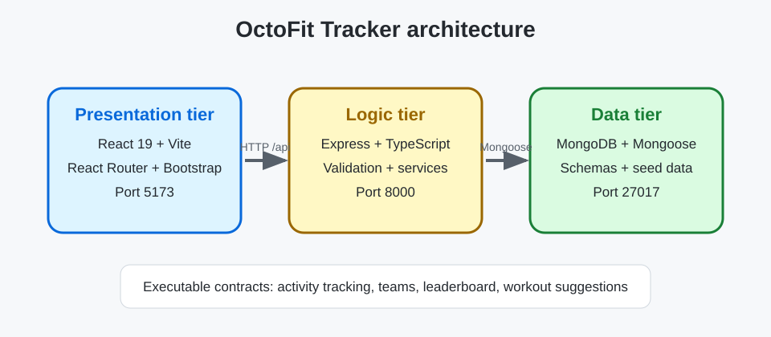

# OctoFit Tracker architecture

OctoFit Tracker is a three-tier application for a school fitness program. The starter code includes API contracts and intentionally incomplete implementation points so you can use GitHub Copilot agent mode in a test-driven loop.

## Tier boundaries

- **Presentation tier**: React 19, Vite, React Router, Bootstrap, and a shared API client in `octofit-tracker/frontend/src`.
- **Logic tier**: Express and TypeScript routes/services in `octofit-tracker/backend/src` expose `/api/*` behavior on port `8000`.
- **Data tier**: Mongoose models and seed data in `octofit-tracker/backend/src/models` and `src/scripts/seed.ts` persist to MongoDB on port `27017`.

## Ports and environment rules

- MongoDB: `27017`
- Express API: `8000`
- Vite frontend: `5173`
- The browser calls relative `/api` paths. Vite proxies them to `http://localhost:8000`, so the unauthenticated API port stays private in Codespaces. `VITE_API_BASE_URL` can override the base URL.

## API contract

| Capability | Method and path | Expected behavior |
| --- | --- | --- |
| Activity tracking | `GET /api/activities`, `POST /api/activities` | List and create valid activity records. POST accepts `userId`, `teamId`, `type`, and `minutes`; `userId` and `teamId` must be well-formed IDs for an existing user and team; otherwise respond with a deliberate 4xx (never a 500 from a cast error). A created activity stores the submitted `user`, `team`, `type`, and `minutes` plus computed `points` and `occurredAt`. |
| Teams | `GET /api/teams`, `POST /api/teams` | List and create teams with members. Created and listed teams keep the submitted `name` and `mascot`. Reject a team without a name with `400`. |
| Leaderboard | `GET /api/leaderboard` | Return teams ordered by the sum of their activity points, highest first. Each entry has `teamName`, `totalPoints`, and a 1-based `rank`. |
| Workout suggestions | `GET /api/workouts/suggestions/:userEmail` | Recommend workouts from recent activity patterns for the matching seeded user's email address. The first suggestion's `focus` matches that user's goal or recent activity, with a `reason` explaining why. An email with no matching user returns a deliberate 4xx (for example, `404`). |

## Implementation decisions

Record your plan here before editing code.

- Presentation tier decision: Use the shared API client from each capability view and expose accessible loading, empty, and error states.
- Logic tier decision: Keep Express routes thin; validate inputs and implement business behavior in service functions with deliberate 4xx errors.
- Data tier decision: Enforce required fields in Mongoose schemas and keep the seed idempotent without clearing application data.
- Activity tracking approach: Validate user/team IDs and references before writing; set `points` from submitted minutes and `occurredAt` on the server.
- Team management approach: Require a team name, preserve the submitted name and mascot, and maintain the members array.
- Leaderboard approach: Sum activity points by team, sort highest first, and assign 1-based ranks.
- Workout suggestions approach: Resolve the user by email, prefer a workout matching their goal and then recent activity, include a reason, and return 404 for an unknown user.

## Test plan

Commands run and what their failures mean:

- `npm run test:data --prefix octofit-tracker/backend`: passed 5/5 after schema validation changes. Before the changes, four model-validation tests failed; seed idempotency/preservation passed.
- `npm run test:api --prefix octofit-tracker/backend`: passed 4/4 after implementing service behavior.
- `npm test --prefix octofit-tracker/backend`: passed 9/9.
- `npm test --prefix octofit-tracker/frontend`: passed 15/15 after dependencies were available. The earlier run could not load `dom-accessibility-api` because the install was interrupted; it did not reach frontend assertions.
- `npm run build --prefix octofit-tracker/backend`: passed.
- `npm run build --prefix octofit-tracker/frontend`: passed.
- `node .github/scripts/grade-step.mjs step1-architecture`: passed. The starter-specific `node --test --test-name-pattern="step one requires a completed architecture plan" tests/exercise-validation.test.mjs` assertion expects this repository's plan to remain blank, so it fails after the required decision record is completed; this is not an application contract failure.
